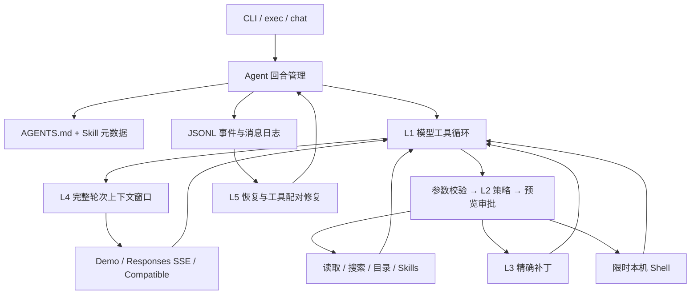

# kraken-coder

一个以 **Codex 开源实现为参考的 Coding Agent 教学项目**，沿用 `my-hermes` 的学习方式：可运行的外围框架、独立的学习算法与参考实现、中文逐阶段教程，以及不需要密钥的离线验收。

使用 **TypeScript + Node.js 24+**，构建产物没有第三方运行时依赖。重点是读懂“用户任务 → 模型决策 → 工具审批与执行 → 观察结果 → 修改代码 → 测试 → 会话恢复”的完整链路。它是独立实现，不需要安装 Codex，也不调用本机 Codex CLI。

## 五分钟运行

```bash
npm install
npm run demo -- --trace
npm run check -- --all --mode reference
npm run check -- --all --mode learner
npm run verify
```

`demo` 创建并打印一个临时项目，实际执行以下步骤：

1. 读取 `AGENTS.md` 和存在 bug 的 `calculator.js`。
2. 运行三个测试，得到退出码 `1`。
3. 用 `apply_patch` 把 `return a - b` 改成 `return a + b`。
4. 再次运行测试，得到退出码 `0`。
5. 完成计划，把消息、工具调用与事件保存到 JSONL。

临时项目会保留，便于查看修改和日志；验收与自动化测试产生的临时文件会清理。Demo 使用确定性脚本，**不是语言模型**；`demo/check` 不读取线上配置、不调用在线模型。`demo` 仅在它刚创建的项目内运行固定命令，自动启用 shell 与 `full-auto`。

## 像 my-hermes 一样学习

[`src/learning/exercises.ts`](src/learning/exercises.ts) 是学习入口，六个核心算法都已实现并有中文注释，可以直接调试，也可以自己清空某个函数体重新写。[`reference.ts`](src/learning/reference.ts) 提供独立参考答案。

`--mode learner` 真正使用学习版，**不会在异常时回退到参考答案**。L0～L5 会接入真实运行链路；L6 学习扩展基础设施，两种模式共用。

| 阶段 | 你会学到什么 | 主要阅读位置 | 独立验收 |
| --- | --- | --- | --- |
| L0 | HTTP 响应、工具 schema、调用 ID、推理字段 | `decodeChat`、`providers/` | `npm run check -- --stage 0 --mode learner` |
| L1 | 一轮任务中的模型/工具循环、取消、步数限制 | `runLoop` | `npm run check -- --stage 1 --mode learner` |
| L2 | 参数校验、预览、审批、策略矩阵 | `decide`、`tools/registry.ts` | `npm run check -- --stage 2 --mode learner` |
| L3 | 精确补丁、冲突检测、工作区路径约束 | `replaceText`、`tools/patch.ts` | `npm run check -- --stage 3 --mode learner` |
| L4 | 按完整轮次裁剪上下文、保护工具配对 | `fitContext` | `npm run check -- --stage 4 --mode learner` |
| L5 | 追加日志、恢复、未知执行结果、独占锁 | `replay`、`session/store.ts` | `npm run check -- --stage 5 --mode learner` |
| L6 | 目录指令、按需加载 Skill、计划工具 | `context/instructions.ts`、`tools/builtins.ts` | `npm run check -- --stage 6 --mode learner` |

每个阶段报告具名 case 和错误，失败时退出码为 `1`。阶段 0 使用本机 HTTP 模拟服务器，不需要 API Key。详细推导、断点与改写任务见 [学习路线](docs/03-learning-path.md)。

## 架构



## 交互和会话

```bash
npm run dev -- chat --provider demo --approval read-only --session study
# 输入：/files、/read README.md、/search runLoop
# /new 开启新会话；/quit 退出；/help 查看命令

npm run dev -- exec --provider demo --message '/read package.json' --session study
npm run dev -- sessions
npm run dev -- history study
```

同一个 `--session` 会恢复之前的上下文，默认新命令创建新会话。`--cwd PATH` 指定工作区，`--home PATH` 指定运行数据目录，默认是工作区的 `.kraken-coder/`。可以查看会话 JSONL，但不要把它当成可任意编辑的配置文件。

```bash
npm run dev -- exec --provider demo --message /files --json
```

`--json` 向 stdout 输出 JSONL 事件，适合后续接 UI；提示信息走 stderr。Responses 的文本增量用 `model.delta` 事件输出。普通终端模式显示最终答复，`--trace` 在 stderr 显示执行摘要。

## 接入真实模型

复制 `.env.example` 为 `.env`，选择协议并填写自己账户可用的模型 ID。没有绑定某个特定或“最新”模型。

OpenAI Responses：

```dotenv
OPENAI_API_KEY=你的密钥
KRAKEN_MODEL=你的模型ID
```

```bash
npm run dev -- doctor --provider responses
npm run dev -- chat --provider responses --approval ask --allow-shell
# 输入自然语言任务，例如：阅读项目，找到 add 的错误，修复并运行相关测试。
```

兼容 Chat Completions 的服务（包括提供该协议的 Kimi 服务）：

```dotenv
KRAKEN_API_KEY=你的密钥
KRAKEN_BASE_URL=服务的v1根地址
KRAKEN_MODEL=服务支持工具调用的模型ID
```

```bash
npm run dev -- doctor --provider compatible
npm run dev -- chat --provider compatible --approval ask --allow-shell
```

两种密钥独立读取，compatible 不自动使用 `OPENAI_API_KEY`。本地无鉴权服务可不填 `KRAKEN_API_KEY`。默认读取**启动目录**的 `.env`，可用 `--env-file PATH` 改变；已有 shell 环境优先。

`doctor` 只报告配置与密钥是否存在。网络协议已通过本机 mock 回归，**没有使用真实密钥完成线上联调**。Responses 保存并回传 reasoning items，遵循 [OpenAI 工具调用协议](https://developers.openai.com/api/docs/guides/function-calling)；实现细节见 [模型接入](docs/06-providers.md)。

## 工具与审批

内置八个工具：`list_files`、`read_file`、`search`、`project_instructions`、`apply_patch`、`shell`、`update_plan`、`read_skill`。

| 策略 | 读取与计划 | 文件补丁 | shell（还需 `--allow-shell`） |
| --- | --- | --- | --- |
| `read-only` | 自动 | 拒绝 | 拒绝 |
| `ask`（默认） | 自动 | 逐次确认 | 逐次确认 |
| `workspace-write` | 自动 | 自动 | 逐次确认 |
| `full-auto` | 自动 | 自动 | 自动 |

审批会展示具体补丁或命令。非交互环境、`--json` 模式没有审批终端，需要审批的操作会得到拒绝结果，交回模型处理。

**这是应用层审批，不是操作系统沙箱。** 文件工具限制在工作区内，并拒绝 `.git`、`.kraken-coder`、真实 `.env`、符号链接和硬链接。开启 shell 后，命令以当前用户身份运行，可访问工作区之外和网络；`cwd` 不是权限隔离。支持 macOS/Linux，暂不支持 Windows shell。边界和补丁格式见 [工具与权限](docs/04-tools-and-permissions.md)。

## AGENTS.md 与 Skills

每轮读取工作区根 `AGENTS.md`。`read_file` 与 `project_instructions` 会返回目标文件从根到所在目录的指令；补丁工具要求新出现或已变化的目录指令先被读取。不会向工作区之外寻找祖先指令，也不实现 `AGENTS.override.md`。

Skill 放在 `<workspace>/.agents/skills/<name>/SKILL.md`，frontmatter 使用单行 `name` 与 `description`。只有元数据进入初始提示词，正文由 `read_skill` 按需加载。可复制 [review 示例](examples/skills/review/SKILL.md)，再用 `skills` 命令检查。Skill 是文本程序说明，不会被自动当作 JavaScript 执行。

## 开发与调试

```bash
npm run typecheck
npm test
npm run build
node dist/cli.js demo --mode learner
node --inspect-brk --import tsx src/cli.ts check --stage 1 --mode learner
```

VS Code 按 F5 可选择阶段验收、完整演示或只读聊天；原先残留的扩展调试入口已替换为实际可运行的 Node 调试配置。

`npm run verify` 包含类型检查、回归测试、两份算法的全部阶段验收和构建。CI 配置在 macOS/Linux 的 Node 24 环境执行相同命令。

```text
src/
  cli.ts                 终端、配置选择、审批、取消
  core/                  协议类型、验证、单回合编排
  providers/             Demo、Chat Completions、Responses、SSE
  tools/                 注册表、文件边界、补丁、本机命令
  context/               目录指令、Skill 索引、提示词
  session/               JSONL 日志、独占锁、读取
  learning/              独立的 learner / reference 算法
  lab.ts                 L0～L6 离线阶段验收
  demo-project.ts        临时练习项目生成器
```

## 教学取舍

本项目完整实现上述学习范围。Codex 上游更广泛的工程功能——原生 TUI、app-server 协议、OAuth 登录、OS 沙箱、远端 compaction、MCP、插件运行时、多 Agent、PTY 长任务——不在这个版本内。这里的 L4 是可检查的**整轮裁剪**，不是语义摘要；shell 是限时的一次性命令，不支持后台任务恢复。多文件补丁先做全量预检，但不提供跨文件崩溃事务。

上游参考固定为本机 `/Users/bill/code/codex` 的提交 `5c3ff1dabf644169f4bd74b215719f381e4fdb3f`。具体源码路径、对应关系与差异见 [Codex 源码导读](docs/02-codex-reference.md)。

[文档导航](docs/README.md) · [架构](docs/01-architecture.md) · [学习路线](docs/03-learning-path.md) · [工具与权限](docs/04-tools-and-permissions.md) · [会话与上下文](docs/05-sessions-and-context.md) · [模型接入](docs/06-providers.md) · [调试与排错](docs/07-debugging.md)
