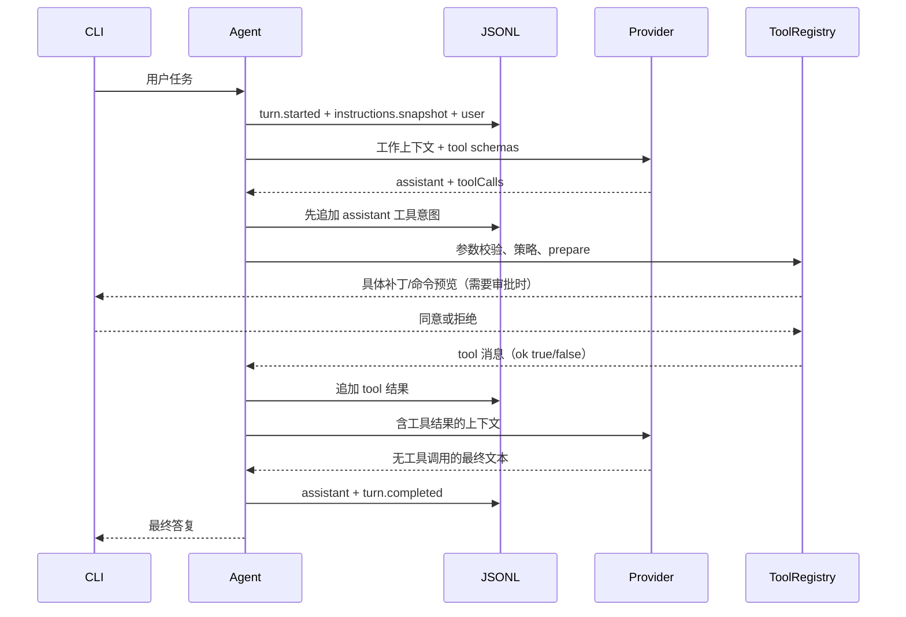

# 01 · 从聊天程序到 Coding Agent

一个聊天程序把问题发给模型，再打印文本。Coding Agent 多了一个闭环：模型可以提出工具调用，宿主执行后把结果作为下一次输入。这个闭环反复运行，直到模型不再提出工具调用，或者预算、取消信号、协议错误终止回合。

## 四层分工

| 层 | 文件 | 负责 | 不负责 |
| --- | --- | --- | --- |
| 交互层 | `src/cli.ts` | 参数、终端、用户审批、事件显示 | 模型循环和文件算法 |
| 回合层 | `src/core/agent.ts` | 配置、指令、会话锁、恢复、预算、事件持久化 | HTTP 协议细节 |
| 决策层 | `src/learning/*.ts` | 模型与工具循环、策略、上下文、恢复算法 | 直接操作 stdin/stdout |
| 适配层 | `src/providers/`、`src/tools/` | HTTP/流解析、文件操作、进程 | 判断用户任务是否语义完成 |

这个边界让同一个循环能够在没有模型密钥时使用 DemoProvider，在协议测试时使用 HTTP mock，在真实项目里使用 ResponsesProvider。`src/index.ts` 暴露 `runTurn`、Provider 和工具注册表，后续可以添加 UI 而不用重写核心。

## 三个时间尺度

- **Session**：长期会话，跨进程恢复。同一 ID 绑定规范化的工作区路径和 Provider 身份（协议、模型、endpoint）。
- **Turn**：一次用户输入到完成或失败，持有 session 写锁，具有总超时。
- **Step**：一次模型请求，可能提出 0～16 个工具调用。一次工具调用不是单独一个 step。

`maxSteps=1` 允许模型直接回答；如果它想调用工具，会在执行前报步数耗尽。这样不会在明知没有后续解释机会时启动新的修改。此前步骤已经发生的修改仍然存在。

## 跟踪一个实际回合



普通工具错误是模型可以观察的数据，例如不存在的文件、参数格式错误、用户拒绝。它们返回 `{"ok":false,"error":"..."}`，模型可以修正。

网络失败、响应不完整、模型返回重复 ID、上下文容不下当前回合，以及取消信号，会终止回合。不能把它们包装成“任务完成”。

## 统一消息协议

`Message` 有 `role` 和 `content`。assistant 额外包含 `toolCalls`，tool 包含对应的 `toolCallId`。每条 assistant 的工具调用必须全部得到结果，才能添加下一个 user/assistant。

```text
user: 修复问题
assistant: toolCalls=[{id: A, name: read_file, ...}]
tool: toolCallId=A, content={ok:true,...}
assistant: toolCalls=[{id: B, name: apply_patch, ...}]
tool: toolCallId=B, content={ok:false,error:"Patch context is ambiguous"}
assistant: 读取更多上下文 / 重新调用 / 给出说明
```

可见文本和工具调用可以同时出现。`content` 非空不等于最终答复；唯一正常结束条件是“有效 assistant 响应且没有工具调用”。

兼容模型的 `reasoningContent` 与 Responses 的 `responseItems` 属于继续请求所需的协议上下文，不混入最终答复。它们会写入本地日志，因此会话日志也属于需要妥善管理的项目数据。

## 模式切换为什么有用

`algorithms(mode)` 返回完整算法表，回合层、工具层、模型层和恢复层都通过它调用学习函数。学习版从来不导入 `reference.ts`。

L0 只影响 Chat Completions 解码，Responses 解码器是共用基础设施。L1～L5 分别影响循环、审批、补丁、窗口和恢复。L6 无单独算法分支，是对指令与 Skill 基础设施的综合练习。

## 事件不是消息

`model.start`、`approval.request`、`files.changed` 和 `plan.updated` 用于观察系统，不自动成为模型消息。`message` 事件才是恢复模型历史的来源。`instructions.snapshot` 保存每轮实际指令供排查，恢复时重新加载当前文件。

Responses 的 `model.delta` 可通过 `--json` 实时显示，但不逐块持久化；只有完整响应才写成 assistant 消息。这避免把断线前的一半工具参数当成可恢复状态。

目前工具顺序执行。即使模型一次请求多个工具，也不会并发写同一文件；这个选择使初学者更容易理解轨迹顺序。未来加入并发时，需要显式声明只读性和冲突关系，不能简单 `Promise.all` 所有工具。
