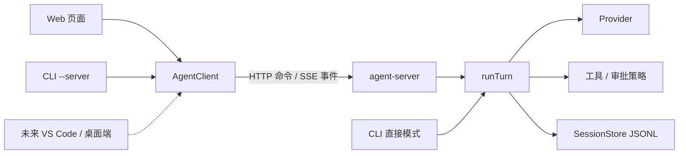
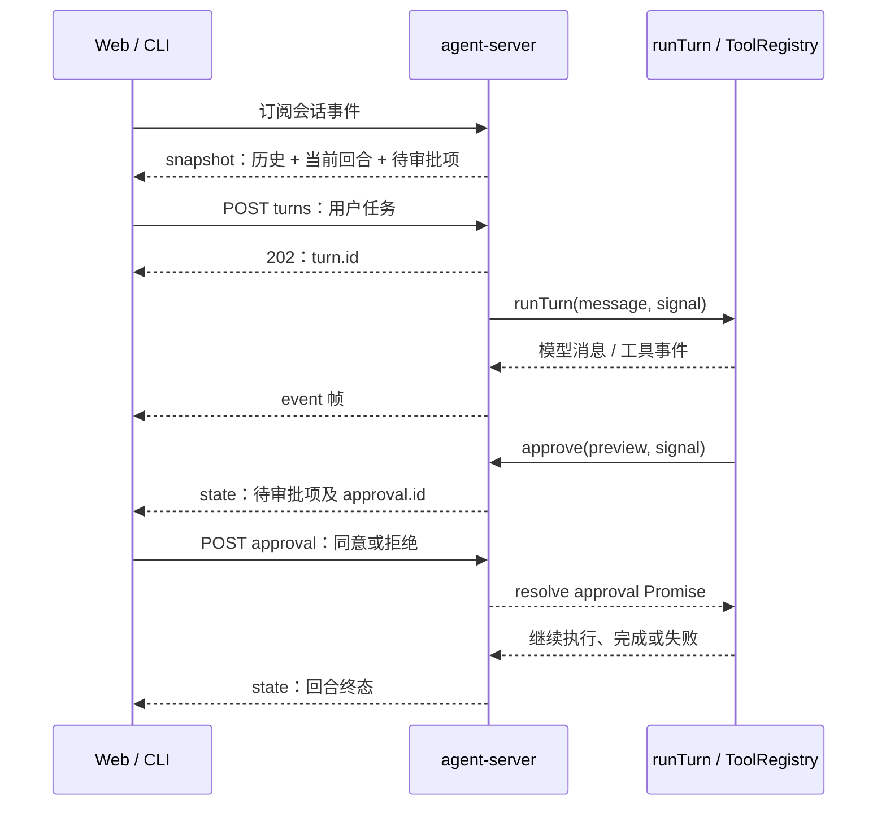

# 10 · 一个 Agent，多种客户端

Web 页面和 CLI 可以连接同一个本机 `agent-server`。服务端持有模型连接、工作区、会话、执行中的回合和审批；客户端负责显示状态、提交任务、回复审批与发送取消请求。新增 VS Code 扩展时，可以继续复用这个边界。

这版提供项目自己的 **HTTP + SSE v1 协议**，不兼容 Codex 上游 app-server 协议。VS Code 扩展与桌面客户端尚未实现。

## 运行

在项目根目录启动：

```bash
npm run serve -- --mode learner --allow-shell
# 等价：npm run dev -- serve --mode learner --allow-shell --port 4317
```

服务读取启动目录的 `.env`，默认监听 `127.0.0.1:4317`，默认审批策略仍为 `ask`。打开终端打印的完整 URL。页面支持新建/切换会话、聊天、工具调用与结果、审批、取消和断线重连。省略 `--allow-shell` 时，文件读取和审批后的补丁仍可使用，shell 不可执行。

离线观察同一套客户端和协议：

```bash
npm run serve -- --provider demo --approval read-only
# 页面输入 /files 或 /read README.md
```

Demo 的动作来自固定脚本，不能理解任意自然语言。真实模型的接入方式见 [06 模型接入](06-providers.md)。

服务打印的地址形式为 `http://127.0.0.1:4317/#token=...`。这里的 token 授权客户端访问当前服务；它与 LLM API Key 独立。浏览器读取 fragment 后保存到当前标签页的 `sessionStorage`，再清除地址栏中的 fragment。API Key 始终由服务端读取，页面没有模型密钥配置表单。

连接同一个服务的 CLI：

```bash
# 将 URL 替换为 serve 打印的完整地址
npm run dev -- chat --server 'http://127.0.0.1:4317/#token=...'

# 加入已有会话，ID 可从 Web 会话信息中获取
npm run dev -- chat --server 'http://127.0.0.1:4317/#token=...' --session SESSION_ID

# 一次任务，stdout 输出 JSONL 事件
npm run dev -- exec --server 'http://127.0.0.1:4317/#token=...' --message '/files' --json
```

也可通过 `KRAKEN_SERVER_TOKEN` 环境变量传入连接 token，此时 `--server` 只填服务地址。模型、模式、审批策略、shell 权限和工作区由服务启动参数决定，客户端不能通过提交任务修改它们。普通 `chat/exec` 不加 `--server` 时，仍直接调用本地核心。

## 源码边界



| 入口 | 负责的状态 |
| --- | --- |
| [`web/app.js`](../web/app.js) | 当前页面选中的会话、消息视图、输入草稿、连接状态 |
| [`src/client/client.js`](../src/client/client.js) | HTTP 请求、token、SSE 帧解析；浏览器与 CLI 共用 |
| [`src/client/remote-turn.ts`](../src/client/remote-turn.ts) | CLI 回合等待、终端审批、取消请求 |
| [`src/server/protocol.ts`](../src/server/protocol.ts) | 跨客户端的数据类型与协议版本 |
| [`src/server/server.ts`](../src/server/server.ts) | 执行中的回合、审批 Promise、事件订阅与本机 HTTP 服务 |
| [`src/core/agent.ts`](../src/core/agent.ts) | 指令、上下文、模型/工具循环、会话日志与回合超时 |

客户端不会把工具名解释成一次文件写入或 shell 执行。它把审批 ID 和布尔决定交回服务端，服务端才让原来等待的工具调用继续。这样 Web 和 CLI 展示不同界面，也能遵守同一份执行策略。

## 命令、状态与事件

三个 ID 分别解决不同问题：

- `session.id`：定位长期会话及 JSONL 历史，绑定工作区与 Provider 身份。
- `turn.id`：定位一次正在运行的用户任务，用于取消和状态跟踪。
- `approval.id`：定位一次具体操作的审批，附带所属 `turnId`；不是对某类工具的永久授权。

所有 API 请求使用 `Authorization: Bearer <token>`。修改请求使用 `Content-Type: application/json`；以下路径都以 `/api/v1` 为前缀。

| 方法与路径 | 输入 | 返回 / 行为 |
| --- | --- | --- |
| `GET /info` | — | 版本、工作区、provider/model、模式、审批策略、shell 是否启用 |
| `GET /sessions` | — | `{ sessions }`，当前工作区与 Provider 匹配的会话 |
| `POST /sessions` | `{}` | `{ session }`，创建并持久化一个空会话 |
| `GET /sessions/:id` | — | `SessionSnapshot`：会话、可见事件、回合状态、待审批项 |
| `GET /sessions/:id/events` | — | SSE：先发送完整快照，随后发送事件与状态变化 |
| `POST /sessions/:id/turns` | `{ "message": "..." }` | HTTP 202 与 `{ turn }`，后台开始执行 |
| `POST /sessions/:id/turns/:turnId/cancel` | `{}` | 请求取消，最终状态通过事件流确认 |
| `POST /sessions/:id/approvals/:approvalId` | `{ "approved": true }` | 回复该审批；`false` 表示拒绝 |

`202` 只表示接受了任务，不能当作完成。回合状态为 `running`、`completed`、`cancelled` 或 `failed`。拒绝某个工具审批会作为工具结果反馈给模型；它不必然使整个回合失败。

服务一次只运行一个回合，覆盖它管理的所有会话。冲突提交返回 `409`，避免多个客户端通过同一服务同时修改工作区。重复审批、已经取消的审批以及已结束回合的取消请求也会返回 `409`；客户端应刷新状态，而不是继续操作旧卡片。



SSE 的 `data:` 是 `ServerFrame` JSON，分为三类：`snapshot` 替换客户端完整视图，`event` 追加一条可见运行事件，`state` 更新回合与待审批列表。`event` 帧携带 `sessionId` 和 `turnId`；即使任务完成先于提交请求的 HTTP 确认、另一个客户端又启动了后续回合，CLI 仍能按回合 ID 取回自己的结果。工具调用与结果继续使用核心的 `toolCalls[].id` / `toolCallId` 配对。

待审批界面以快照或 `state.approvals` 为准，不能把历史 `approval.request` 重新显示成可操作卡片。同一 token 的多个客户端都可回复，第一次有效回复结束等待，其他客户端的旧回复会被拒绝。

## 重连与进程恢复

页面断开连接只移除订阅，回合仍由服务端执行。重新订阅时，服务端发送新的完整快照，页面据此恢复历史、运行状态和审批卡片。客户端收到快照应替换已有视图，不能再追加一次历史。

等待审批也计入原有回合总超时；关闭页面不会暂停计时。终端 `Ctrl+C` 则是显式取消当前回合的操作。

当前采用完整快照重连，没有实现按游标补发、事件恰好一次投递或提交任务的幂等键。提交请求发生网络错误时，任务可能已经被接受；应先查看会话状态，避免直接自动重试并重复运行任务。共享 SDK 不会自动重试任务提交。

Web 可随时查看并处理运行中的会话；当前 CLI 适配器在提交自己的回合时订阅事件，断线后会报错，不自动重连或接管其他客户端已有的审批。后续可在 SDK 上增加独立的 CLI 观察/接管命令。

`model.delta` 仅在当前连接中展示，没有逐块持久化；完整 assistant 消息才进入 JSONL。Responses 可产生文本增量，当前 compatible Provider 仍是非流式回复。重连可以恢复已完成消息，不保证补齐中断期间的临时文本增量。

停止服务器会取消它管理的活动回合并释放审批等待。重新启动后可以读取会话历史，但不会恢复原进程中的 Promise、审批 ID 或继续执行旧任务。没有终态的旧回合显示为中断；发送新任务时，已有 `replay` 逻辑仍将缺失工具结果处理为未知，不自动重跑副作用。

## 本机服务的边界

服务仅绑定 `127.0.0.1`，校验 Host、Origin 和 API token，没有开放跨域访问。静态资源采用固定列表，不会把整个工作区变成文件服务器。`/info` 不返回模型密钥；发送给客户端的消息移除 `reasoningContent`、`responseItems` 和系统指令快照，模型恢复仍使用服务端的完整日志。

连接 token 可提交任务和回复审批，因此持有 token 的客户端具有相同控制权。这版没有多用户身份、不同客户端权限、远程部署鉴权或 OS 沙箱。原有 shell 仍以当前系统用户运行；仅监听本机不改变工具执行权限。一次一个回合的约束也只覆盖当前服务实例，不是跨进程的工作区锁。

## 后续接 VS Code

扩展的第一步是作为另一个客户端：在 extension host 内使用 `AgentClient`，把状态转给 Webview，接收用户输入、审批和取消动作。工作区由服务器选择，扩展无需再实现模型循环、存储和工具执行。

之后再按需求补充服务启动/发现与退出管理、多工作区路由、协议能力协商、选区/文件引用、编辑器跳转和 diff 视图。若需要网络不稳定环境或跨机器运行，还应单独设计提交幂等、事件游标及身份权限。它们都是后续工作，当前 Web 和 CLI 接口不代表这些扩展已完成。
