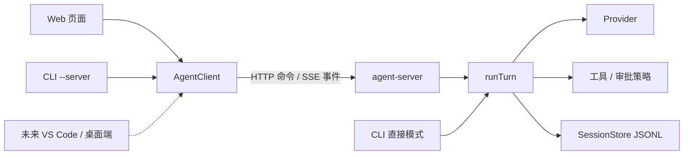
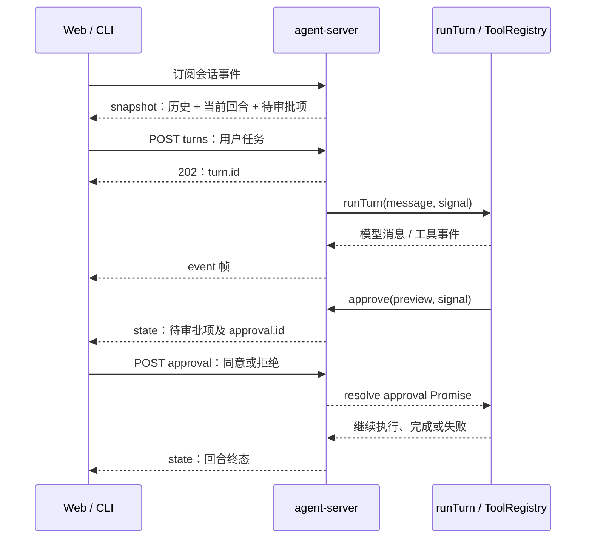

# 10 · 一个 Agent，多种客户端

Web 页面和 CLI 可以连接同一个本机 `agent-server`。服务端持有模型连接、工作区、会话、执行中的回合和审批；客户端负责显示状态、提交任务、回复审批与发送取消请求。新增 VS Code 扩展时，可以继续复用这个边界。

这版提供项目自己的 **HTTP + SSE v1 协议**，不兼容 Codex 上游 app-server 协议。VS Code 扩展与桌面客户端尚未实现。

## 运行

在项目根目录启动：

```bash
npm run serve -- --mode learner --allow-shell
# 等价：npm run dev -- serve --mode learner --allow-shell --port 4317
```

服务从启动目录的 `.env` 读取模型配置和 API Key，默认审批策略为 `ask`。在本机浏览器打开 <http://127.0.0.1:4317/>，页面会自动连接。指定其他端口时，打开终端打印的地址。页面支持新建/切换会话、聊天、工具调用与结果、审批、取消和断线重连。省略 `--allow-shell` 时，文件读取和审批后的补丁仍可使用，shell 不可执行。

点击输入框下方的权限名称，或打开右上角「运行设置」，可以选择工具审批模式。这里也可以调整单次请求和整轮时限、上下文压缩比例及模型窗口。设置保存到 `.env`，从下一轮任务生效。其他客户端打开设置时会重新读取最新值。手动配置见 [模型配置](06-providers.md)。

离线观察同一套客户端和协议：

```bash
npm run serve -- --provider demo --approval read-only
# 页面输入 /files 或 /read README.md
```

Demo 的动作来自固定脚本，不能理解任意自然语言。真实模型的接入方式见 [06 模型接入](06-providers.md)。

连接同一个服务的 CLI：

```bash
npm run dev -- chat --server http://127.0.0.1:4317

# 加入已有会话，ID 可从 Web 会话信息中获取
npm run dev -- chat --server http://127.0.0.1:4317 --session SESSION_ID

# 一次任务，stdout 输出 JSONL 事件
npm run dev -- exec --server http://127.0.0.1:4317 --message '/files' --json
```

模型、算法模式、shell 开关和工作区由服务启动配置决定。审批策略可通过设置接口更改，提交任务只需发送消息。普通 `chat/exec` 不加 `--server` 时直接调用本地核心。

## 源码边界



| 入口 | 负责的状态 |
| --- | --- |
| [`web/app.js`](../web/app.js) | 当前页面选中的会话、消息视图、输入草稿、连接状态 |
| [`src/client/client.js`](../src/client/client.js) | 浏览器与 CLI 共用的 HTTP 请求和 SSE 帧解析 |
| [`src/client/remote-turn.ts`](../src/client/remote-turn.ts) | CLI 回合等待、终端审批、取消请求 |
| [`src/server/protocol.ts`](../src/server/protocol.ts) | 跨客户端的数据类型与协议版本 |
| [`src/server/server.ts`](../src/server/server.ts) | 执行中的回合、审批 Promise、事件订阅与本机 HTTP 服务 |
| [`src/core/agent.ts`](../src/core/agent.ts) | 指令、上下文、模型/工具循环、会话日志与回合超时 |

客户端把审批 ID、是否批准和可选的记忆选择交回服务端。服务端核对该待审操作后继续工具调用，Web 和 CLI 共用同一份执行策略。

## 命令、状态与事件

三个 ID 分别解决不同问题：

- `session.id`：定位长期会话及 JSONL 历史，绑定工作区与 Provider 身份。
- `turn.id`：定位一次正在运行的用户任务，用于取消和状态跟踪。
- `approval.id`：定位一次具体操作的审批，附带所属 `turnId`；不是对某类工具的永久授权。

本机客户端可直接请求 `/api/v1` 下的接口，例如 `curl http://127.0.0.1:4317/api/v1/info`。修改请求使用 `Content-Type: application/json`。下表省略 `/api/v1` 前缀。

| 方法与路径 | 输入 | 返回 / 行为 |
| --- | --- | --- |
| `GET /info` | — | 版本、工作区、provider/model、模式、审批策略、shell 是否启用 |
| `GET /settings` | — | 审批模式、两个时限（毫秒）、窗口配置、压缩比例和生效预算 |
| `POST /settings` | 可单独提交 `approval`，也可提交两个时限字段、`contextWindowTokens` 和 `contextCompactRatio` | 保存到环境文件，从下一轮生效 |
| `GET /sessions` | — | `{ sessions }`，当前工作区与 Provider 匹配的会话 |
| `POST /sessions` | `{}` | `{ session }`，创建并持久化一个空会话 |
| `GET /sessions/:id` | — | `SessionSnapshot`：会话、可见事件、回合状态、待审批项 |
| `GET /sessions/:id/events` | — | SSE：先发送完整快照，随后发送事件与状态变化 |
| `POST /sessions/:id/turns` | `{ "message": "..." }` | HTTP 202 与 `{ turn }`，后台开始执行 |
| `POST /sessions/:id/turns/:turnId/cancel` | `{}` | 请求取消，最终状态通过事件流确认 |
| `POST /sessions/:id/inputs` | `{ turnId, kind: "steer" \| "follow_up", message }` | 将消息加入当前回合的待发队列 |
| `POST /sessions/:id/inputs/:inputId/remove` | `{}` | 移除还未送达的消息 |
| `POST /sessions/:id/inputs/resume` | `{}` | 空闲时启动第一条暂停的 follow-up |
| `POST /sessions/:id/approvals/:approvalId` | `{ "approved": true }`，可选 `"remember": true` | `false` 拒绝。只有待审项含服务端生成的 `commandPrefix` 且用户批准时才能记住 |

`202` 只表示接受了任务，不能当作完成。回合状态为 `running`、`completed`、`cancelled` 或 `failed`。拒绝某个工具审批会作为工具结果反馈给模型；它不必然使整个回合失败。

服务一次只运行一个回合，覆盖它管理的所有会话。冲突提交返回 `409`，避免多个客户端通过同一服务同时修改工作区。重复审批、已经取消的审批以及已结束回合的取消请求也会返回 `409`；客户端应刷新状态，而不是继续操作旧卡片。



SSE 的 `data:` 是 `ServerFrame` JSON，分为三类：`snapshot` 替换客户端完整视图，`event` 追加一条可见运行事件，`state` 更新回合、待审批和待发消息列表。`event` 帧携带 `sessionId` 和 `turnId`；即使任务完成先于提交请求的 HTTP 确认、另一个客户端又启动了后续回合，CLI 仍能按回合 ID 取回自己的结果。工具调用与结果继续使用核心的 `toolCalls[].id` / `toolCallId` 配对。

待审批界面以快照或 `state.approvals` 为准，不能把历史 `approval.request` 重新显示成可操作卡片。连接同一服务的本机客户端都可回复，第一次有效回复结束等待，其他客户端的旧回复会被拒绝。

运行中可以按 Enter 或点「调整当前任务」发送 steer。正在进行的模型请求和整组工具先结束，随后把新指令作为用户消息写入当前回合，交给下一次模型请求。调整沿用当前回合的步数与时限，步数用尽时待发区会显示「未送达」。

点击「排到下一轮」可追加 follow-up。当前回合成功且 steer 已送达后，服务按入队顺序调用 `runTurn`，每条都有自己的回合 ID 和预算。失败或停止会暂停后续任务，可以用「继续队列」恢复。待发消息可以移除，保存在服务进程内存中，页面刷新会恢复，服务重启会清空。Web 页面和 SDK 提供这些操作。

## 重连与进程恢复

页面断开连接只移除订阅，回合仍由服务端执行。重新订阅时，服务端发送新的完整快照，页面据此恢复历史、运行状态和审批卡片。客户端收到快照应替换已有视图，不能再追加一次历史。

等待审批也计入原有回合总超时；关闭页面不会暂停计时。终端 `Ctrl+C` 则是显式取消当前回合的操作。

当前采用完整快照重连，没有实现按游标补发、事件恰好一次投递或提交任务的幂等键。提交请求发生网络错误时，任务可能已经被接受；应先查看会话状态，避免直接自动重试并重复运行任务。共享 SDK 不会自动重试任务提交。

Web 可随时查看并处理运行中的会话；当前 CLI 适配器在提交自己的回合时订阅事件，断线后会报错，不自动重连或接管其他客户端已有的审批。后续可在 SDK 上增加独立的 CLI 观察/接管命令。

`model.delta` 仅在当前连接中展示，没有逐块持久化；完整 assistant 消息才进入 JSONL。Responses 和 compatible Provider 均支持回答文本增量；compatible 还会把思考文本增量标为 `channel: "reasoning"`，页面分别累积显示。兼容服务返回完整 JSON 时退回整次展示。重连可以恢复已完成消息，不保证补齐中断期间的临时文本增量；失败或取消时清除当前临时文本，不将其作为完整回复保存。

模型接口返回非空 `reasoning_content` 时，页面会在对应的回答或工具调用前显示可折叠的“模型思考”。这是供应商返回的思考文本，不代表完整内部推理；没有返回该字段时，不生成思考卡片。流式思考默认展开，可在生成期间折叠；完整消息到达后接替临时块，保留展开选择，避免重复显示。历史内容随会话快照恢复，展开状态在当前页面切换会话后重置。页面按动画帧合并增量渲染。

停止服务器会取消它管理的活动回合并释放审批等待。重新启动后可以读取会话历史，但不会恢复原进程中的 Promise、审批 ID 或继续执行旧任务。没有终态的旧回合显示为中断；发送新任务时，已有 `replay` 逻辑仍将缺失工具结果处理为未知，不自动重跑副作用。

## 本机服务的边界

服务仅绑定 `127.0.0.1`，检查 Host 并拒绝跨来源请求。静态资源采用固定列表，不会把整个工作区变成文件服务器。`/info` 不返回模型密钥；发送给客户端的消息包含模型返回的 `reasoningContent` 文本，但移除原始 `responseItems` 和系统指令快照，不展示加密推理状态。模型恢复仍使用服务端的完整日志。

任何能访问该端口的本机进程都可以提交任务和回复审批。工具按服务启动时选择的策略执行，启用的 shell 以当前系统用户身份运行。每个服务实例同时只执行一个回合。

## 后续接 VS Code

扩展的第一步是作为另一个客户端：在 extension host 内使用 `AgentClient`，把状态转给 Webview，接收用户输入、审批和取消动作。工作区由服务器选择，扩展无需再实现模型循环、存储和工具执行。

之后再按需求补充服务启动/发现与退出管理、多工作区路由、协议能力协商、选区/文件引用、编辑器跳转和 diff 视图。若需要网络不稳定环境或跨机器运行，还应单独设计提交幂等、事件游标及身份权限。它们都是后续工作，当前 Web 和 CLI 接口不代表这些扩展已完成。
